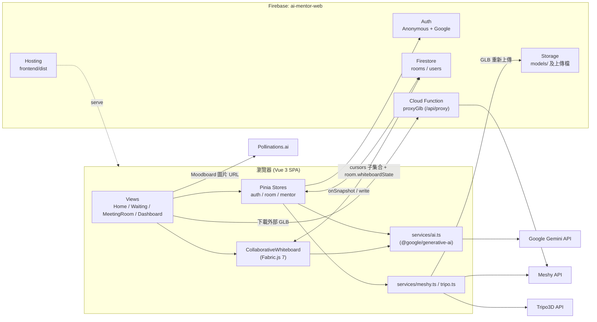
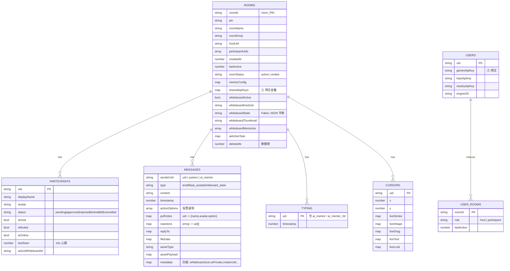
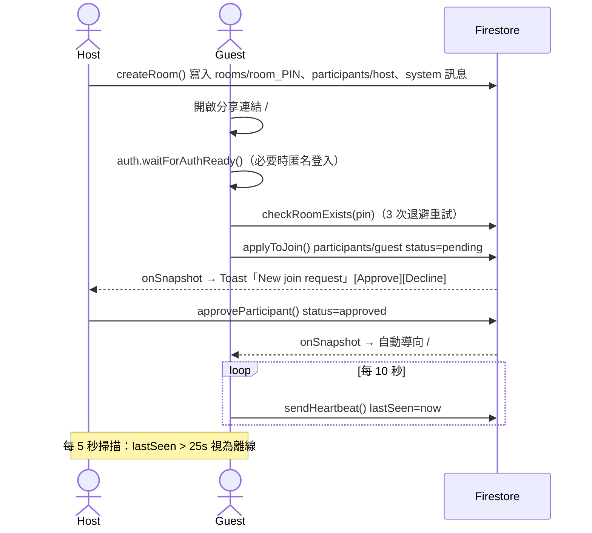
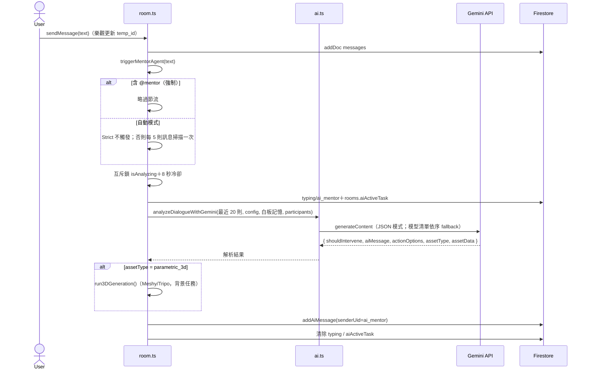
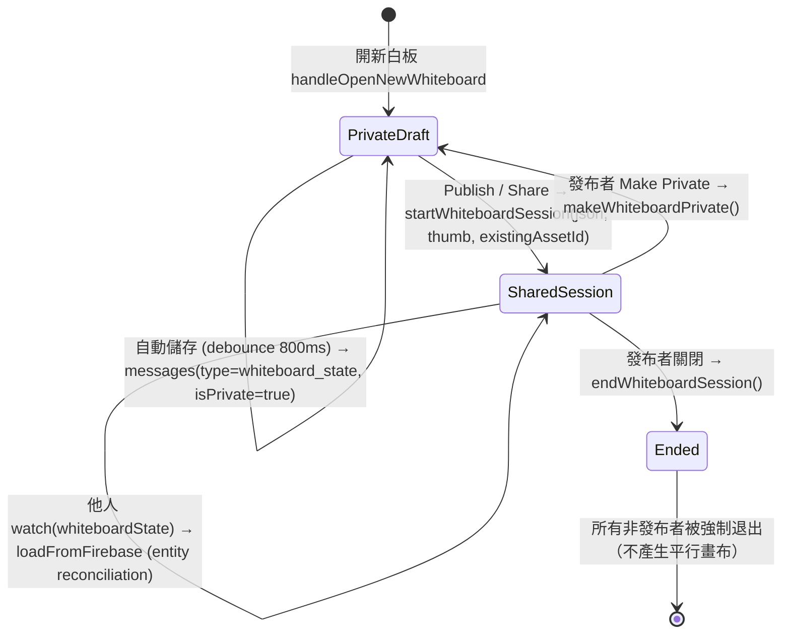

> **歷史文件**：本日誌寫於 2026-10-25，描述 v6.0.0（改版前）的系統。之後 AI 移到 Cloud Functions、入會核准流程與前端 AI 設定已移除。現況請看 `CLAUDE.md` 與 `docs/HANDOFF.md`。

# 🧭 AI Mentor Collaboration Platform — 工程交接日誌

| 項目 | 內容 |
| :--- | :--- |
| 撰寫日期 | 2026-10-25 (UTC+8) |
| 撰寫者視角 | 網頁工程 AI（Antigravity，負責本專案 2026-09-17 ~ 2026-10-07 全程開發） |
| 專案根目錄 | `c:\Users\bb900\.gemini\antigravity\scratch\ai-mentor-platform` |
| Git Remote | `https://github.com/AIPoweredCollaborativeDesignPlatform/ai-mentor-platform.git` |
| 線上網址 | https://ai-mentor-web.web.app （Firebase Hosting） |
| Firebase 專案 | `ai-mentor-web` |
| 最後功能版本 | v6.0.0（2026-10-07）＋ 後續未編號修補（畫布同步／踢出機制） |

> [!CAUTION]
> **交接前必讀的三件事**
> 1. **約 3 週的工作尚未 commit**：Git HEAD 停在 `v2.15.10`（2026-10-03），之後的 v2.15.11 → v6.0.x 全部只存在於工作目錄（17 個檔案，+3319 / −2048 行）。**請先 commit 並 push**，否則一次誤操作就會遺失全部成果。
> 2. **Gemini API Key 會被打包進公開的 JS bundle**（`VITE_GEMINI_API_KEY`），等於公開在網路上，詳見 [§12 安全稽核](#12-安全稽核與風險分級)。
> 3. **右下角版本號是舊的**：`App.vue` 仍顯示 `v5.8.0 (2026-10-06 15:40:00)`，v5.9.0 / v6.0.0 / 後續修補都沒有更新版本號。使用者明確要求每次發佈都要更新版本號與時間戳。

---

## 目錄

1. [專案定位與研究背景](#1-專案定位與研究背景)
2. [現狀快照](#2-現狀快照)
3. [技術棧](#3-技術棧)
4. [目錄結構](#4-目錄結構)
5. [系統架構](#5-系統架構)
6. [資料模型（Firestore Schema）](#6-資料模型firestore-schema)
7. [主要互動流程](#7-主要互動流程)
8. [前端模組職責](#8-前端模組職責)
9. [AI Mentor 設計](#9-ai-mentor-設計)
10. [協作白板引擎設計](#10-協作白板引擎設計)
11. [憑證與設定](#11-憑證與設定)
12. [安全稽核與風險分級](#12-安全稽核與風險分級)
13. [開發、建置與部署](#13-開發建置與部署)
14. [專案歷程時間軸](#14-專案歷程時間軸)
15. [待辦事項與技術債](#15-待辦事項與技術債)
16. [給下一位工程師／AI 的注意事項](#16-給下一位工程師ai-的注意事項)

---

## 1. 專案定位與研究背景

**AI Mentor Collaboration Platform** 是一個以 **Group Conversational Agent (GCA)** 理論為基礎的遠端協作設計平台。AI 被定位為「背景調解者（background mediator）＋視覺資產生成器」，只在出現認知落差、討論停滯、離題或有成員被邊緣化時才建設性地介入。

- **使用情境**：產品／UI/UX／工業設計團隊的遠端會議、客戶決策討論。
- **學術用途**：訊息紀錄會作為學術研究資料，預計送 **IRB 審查**。首頁已加上英文隱私聲明（[HomeView.vue](file:///c:/Users/bb900/.gemini/antigravity/scratch/ai-mentor-platform/frontend/src/views/HomeView.vue#L371-L380)）：AI 會讀取訊息內容與使用者自訂名稱，**但不會讀取登入用的 Gmail／Google 帳號資訊**。
- **核心功能**：
  - 6 位數 PIN 開房 → 等候室 → 主持人審核 → 即時聊天室
  - AI Mentor（Gemini）：自動／`@mentor` 觸發；可產出摘要（含表格）、事實查核、Moodboard、3D 模型、互動投票選項
  - 協作白板（Fabric.js 7）：多人游標、即時筆劃、便利貼、箭頭節點編輯、群組隔離、AI 手繪轉向量
  - 3D：Three.js 參數化幾何（即時）＋ Meshy / Tripo 文字轉 3D（GLB）
  - 資產相簿（公開區／私人區）、Dashboard（房間管理、垃圾桶）

---

## 2. 現狀快照

### 2.1 版本與程式碼狀態

| 項目 | 狀態 |
| :--- | :--- |
| Git HEAD | `ae57960` — v2.15.10（2026-10-03 19:45），共 86 個 commit |
| 未 commit 變更 | 17 個檔案（見下方）＋ `.firebase` hosting cache |
| `npm run build` | ✅ 通過（2026-10-07 最後一次驗證，`vue-tsc` 零錯誤） |
| 最後部署 | v6.0.0 已部署（`firebase deploy --only hosting,firestore:rules`）。**v6.0.0 之後的修補（§2.2）已 build 但未確認是否部署** |
| 畫面版本號 | `v5.8.0 (2026-10-06 15:40:00)` ← **過期，需更新** |

未 commit 的檔案：

```
firestore.rules                          frontend/src/i18n/index.ts
frontend/package.json / package-lock     frontend/src/services/ai.ts
frontend/src/App.vue                     frontend/src/stores/auth.ts
frontend/src/components/CollaborativeWhiteboard.vue
frontend/src/components/DocumentModal.vue  frontend/src/stores/room.ts
frontend/src/components/FactCheckViewer.vue frontend/src/types/index.ts
frontend/src/components/HostControlDrawer.vue frontend/src/views/HomeView.vue
frontend/src/views/MeetingRoomView.vue   frontend/src/views/WaitingRoomView.vue
```

### 2.2 最後一輪工作（2026-10-07，v6.0.0 之後，未編號）

| 需求（使用者原文摘要） | 處理方式 | 狀態 |
| :--- | :--- | :--- |
| 事實查核文獻預設收合、連結超出訊息框 | `FactCheckViewer.vue` 收合膠囊＋`break-all` | ✅ |
| 自訂選項前有兩個「+」 | 移除重複圖示 | ✅ |
| 公開區顯示 2 但清單空白 | 補上 summary / contract / fact_check 卡片模板 | ✅ |
| AI 讀懂訊息表情回應 | `ai.ts` 將 reactions 轉為 `[Message Reactions: …]` 注入 transcript，並在 system prompt 定義 6 種表情語意 | ✅ |
| 分享連結偶發「房間不存在」需重整 | `auth.waitForAuthReady()`＋`checkRoomExists` 3 次退避重試 | ✅ |
| 對方筆劃完成後短暫消失；圖片／縮放需移動畫布才更新；文字停在 "Type here" | liveStroke 保留到正式物件到達；image `load` 觸發重繪；所有文字類物件同步 | ✅ |
| 便利貼垂直縮小彈回、跨端尺寸不一 | 移除 180px `Math.max` 下限，改為 `dynamicMinH`（依文字高度） | ✅ |
| 同時編輯無法收斂 | `checkConvergenceHeartbeat()`：儲存後 1.2s＋每 3s 閒置比對 | ✅ |
| A 關閉畫布後 B 仍進入 → 平行畫布 | `MeetingRoomView` 監聽 `whiteboardActive=false` 一律踢出非發布者；加入前先檢查；白板元件內部雙重監聽 | ✅ |

> [!WARNING]
> 以上修補**尚未經過多人實機測試**，建議以 2~3 個瀏覽器（含無痕視窗）實測 §7.3 的白板流程後再部署。

---

## 3. 技術棧

| 層級 | 技術 | 版本 / 備註 |
| :--- | :--- | :--- |
| 前端框架 | Vue 3 (`<script setup>` + TS) | `^3.5.13` |
| 狀態管理 | Pinia | `^2.3.1` |
| 路由 | vue-router（**Hash 模式**） | `^4.5.0` |
| 建置 | Vite 6 + vue-tsc | `npm run build = vue-tsc && vite build` |
| 樣式 | Tailwind CSS 3 + PostCSS | 深色主題 `bg-slate-950` |
| 白板 | Fabric.js | `^7.4.0`（v7 API，注意與 v5 文件差異） |
| 3D | Three.js `^0.183`、`@google/model-viewer ^4` | `model-viewer` 已註冊為 custom element |
| Markdown | marked `^18` + DOMPurify `^3` | 文件／摘要渲染 |
| AI SDK | `@google/generative-ai ^0.24.1` | ⚠️ 舊版 SDK，官方已改推 `@google/genai` |
| 後端（BaaS） | Firebase Auth / Firestore / Storage / Hosting | Firebase JS SDK `^11.3.1` |
| Cloud Functions | Node 20, `firebase-functions ^7` | 僅 `proxyGlb`（GLB CORS 代理） |
| 圖片生成 | Pollinations.ai（Moodboard 圖） | 免金鑰、URL 直出 |
| 3D 生成 | Meshy v2 / Tripo3D v2 OpenAPI | 前端直接呼叫 |
| 舊後端（未使用） | FastAPI (`backend/`) | AI 已於 2026-09-21 遷移到前端，此目錄為遺留 |

開發環境：Windows + PowerShell、Node `v24.15.0`、firebase-tools `15.30.1`。

---

## 4. 目錄結構

```
ai-mentor-platform/
├── firebase.json            # Hosting(frontend/dist) + rewrites(/api/proxy→proxyGlb) + rules
├── .firebaserc              # default project: ai-mentor-web
├── firestore.rules          # Firestore 安全規則
├── storage.rules            # Storage 安全規則（/models 公開讀）
├── cors.json                # Storage bucket CORS（GET/HEAD *）
├── .env.example             # 範本（真正的 .env 在 frontend/）
├── README.md                # 早期架構說明（部分過時：仍寫 FastAPI 為 AI 引擎）
├── functions/index.js       # proxyGlb：express 代理下載外部 GLB
├── backend/                 # ⚠️ 遺留 FastAPI，未被前端呼叫
├── .agents/skills/          # Antigravity skills（Firebase 等）
└── frontend/
    ├── .env                 # VITE_FIREBASE_* + VITE_GEMINI_API_KEY（gitignored）
    ├── vite.config.ts
    └── src/
        ├── App.vue                    # 根元件＋右下角版本號 ← 每次發佈要改
        ├── main.ts / router/index.ts  # 4 個路由
        ├── firebase/config.ts         # Firebase 初始化（含硬編碼 fallback config）
        ├── types/index.ts             # 全域型別（RoomData / MessageItem / CursorData…）
        ├── constants/roomEmojis.ts
        ├── i18n/index.ts              # 介面字串（en / zh-TW / ja / ko）
        ├── stores/
        │   ├── auth.ts      (13 KB)   # 匿名／Google 登入、身分、API key 同步
        │   ├── room.ts      (76 KB)   # 房間、訊息、在線狀態、AI 觸發、白板 session
        │   └── mentor.ts              # MentorConfig（敏感度、模型層級、模組開關）
        ├── services/
        │   ├── ai.ts        (32 KB)   # Gemini：對話分析、白板視覺記憶、SVG 生成/重繪
        │   ├── meshy.ts / tripo.ts    # 文字轉 3D
        │   └── glbProxy.ts            # GLB 重新上傳到 Firebase Storage（解 CORS）
        ├── components/
        │   ├── CollaborativeWhiteboard.vue (390 KB, ~9.9k 行) # 白板引擎（巨型元件）
        │   ├── HostControlDrawer.vue  (56 KB)  # 主持人控制台、API key、AI 設定
        │   ├── ParametricViewer3D.vue / ModelViewerGLB.vue
        │   ├── MoodBoardViewer.vue / DocumentModal.vue / FactCheckViewer.vue
        │   ├── WhiteboardModal.vue / PdfViewerModal.vue
        │   └── ToastContainer.vue / AlertModal.vue
        └── views/
            ├── HomeView.vue           # 首頁：建房／輸入 PIN／Google 登入／IRB 聲明
            ├── WaitingRoomView.vue    # 等候審核
            ├── MeetingRoomView.vue (150 KB) # 主會議室：聊天、資產抽屜、白板容器
            └── DashboardView.vue      # 我的房間、刪除／垃圾桶
```

---

## 5. 系統架構



**關鍵設計決策**

- **無自有後端**：所有業務邏輯（含 AI 呼叫）都在前端執行，Firestore 是唯一的即時同步匯流排。優點是部署簡單、免伺服器費用；代價是 API key 必須出現在客戶端（見 §12）。
- **AI 由「觸發者的瀏覽器」執行**：誰發訊息觸發 AI，就由誰的瀏覽器呼叫 Gemini，結果以 `senderUid: 'ai_mentor'` 寫回 Firestore。用 `rooms/{id}.aiActiveTask` 和 `typing/ai_mentor` 廣播「AI 思考中」狀態。
- **Hash Router**：路由為 `/#/room/123456`，因此分享連結都帶 `#`。
- **Room ID 規則**：`room_${pin}`（6 位數 PIN）。

---

## 6. 資料模型（Firestore Schema）



**白板資產的雙重存放**

| 位置 | 用途 |
| :--- | :--- |
| `rooms/{id}.whiteboardState` | **共享 session 的權威狀態**（只有 `whiteboardActive=true` 期間有效），所有人 watch 它做 reconciliation |
| `rooms/{id}/messages/{msgId}`（`type: whiteboard_state`） | **白板資產本體**：`metadata.whiteboardJson`、`isPrivate`、`wasPublished`、`isSharedPost`、`creatorUid`。公開區／私人區抽屜依此分類 |
| `rooms/{id}/cursors/{uid}` | 高頻、短暫的即時預覽（游標、進行中筆劃、拖曳中變形、打字中文字、鎖定） |

---

## 7. 主要互動流程

### 7.1 建房、入會與審核



- 被踢（`kicked`）／拒絕（`rejected`）可 `reapplyToJoin()` 重新申請。
- 主持人可：靜音、踢人、轉移主持權（`transferHostOwnership`）、結束會議（`endMeetingForAll`）、改房名與 emoji。

### 7.2 訊息與 AI Mentor 介入



- 斜線指令：`/3d`、`/moodboard`、`/fact`（`/retrieve`）、`/summary`（只影響任務標籤，實際內容由 Gemini 決定）。
- 使用者可中止：`abortCurrentAiGeneration()`（AbortController）。
- 失敗時可 `retryAiMentorMessage(messageId)`。

### 7.3 協作白板生命週期（公開／私人）



規則重點：
- 分享既有私人草稿時**原地更新**該訊息（不複製），避免產生多份檔案（使用者明確要求）。
- 參與者加入前會檢查 `whiteboardActive`；session 結束時，`MeetingRoomView` 與白板元件都會強制關閉非發布者的共享畫布。
- 發布者關閉共享後，自己的畫面無縫轉為私人白板。

### 7.4 3D 生成

1. Gemini 回傳 `assetType: 'parametric_3d'`，`assetData` 包含 `components`（Three.js 參數化幾何，立即顯示）與 `prompt3D`（詳細文字轉 3D 提示詞）。
2. 若有 Meshy／Tripo key → 背景建立任務、輪詢 → 取得 GLB URL。
3. `glbProxy.reHostGlbToFirebaseStorage()` 將 GLB 重新上傳到 `Storage /models/`（公開讀）以解決 CORS；失敗時走 `/api/proxy`（Cloud Function）。
4. `ModelViewerGLB.vue` 顯示；可 `refineMeshyModel()` 進行上色／精修。

### 7.5 互動投票

- AI 在 `actionOptions` 放 2~4 個選項 → 前端渲染成投票卡。
- `votePollOption()`：寫入 `pollVotes[uid] = {name, avatar, option}`；再點一次＝取消，點別的＝改投。
- `addCustomPollOption()`：使用者新增自訂選項並自動投給它。
- 投票者大頭貼直接顯示在選項上（不另外發訊息）；投票結果會注入 AI transcript 讓 AI 知道團隊傾向。
- Firestore rules 允許已核准成員只更新 `reactions` / `pollVotes` / `actionOptions` 三個欄位。

### 7.6 `@` 提及

- 輸入 `@` 彈出成員清單（含 `@mentor`），支援方向鍵／Enter／Tab／Esc。
- 被提及者：訊息琥珀色高亮、`@ You were mentioned` 標籤、提示音＋Toast。
- AI 會依「Team Dynamics」主動 `@` 長時間沉默的成員。

---

## 8. 前端模組職責

### 8.1 Stores

| 檔案 | 主要職責 | 重要函式 |
| :--- | :--- | :--- |
| [auth.ts](file:///c:/Users/bb900/.gemini/antigravity/scratch/ai-mentor-platform/frontend/src/stores/auth.ts) | 匿名登入、Google 升級（popup，行動裝置／被擋時改 redirect）、匿名→Google 的房間遷移、顯示名稱／頭像、API key 同步 | `waitForAuthReady`、`initGuestAuth`、`upgradeWithGoogle`、`logoutGoogle`、`syncUserApiKeys` |
| [room.ts](file:///c:/Users/bb900/.gemini/antigravity/scratch/ai-mentor-platform/frontend/src/stores/room.ts) | 房間 CRUD、4 個 onSnapshot（room / participants / messages / typing）、心跳在線狀態、訊息（樂觀更新）、主持人操作、AI 觸發與 3D、白板 session、表情／投票 | `startFirestoreListener`、`createRoom`、`applyToJoin`、`sendMessage`、`triggerMentorAgent`、`startWhiteboardSession`、`syncWhiteboardState`、`endWhiteboardSession`、`makeWhiteboardPrivate`、`toggleMessageReaction`、`votePollOption`、`addCustomPollOption` |
| [mentor.ts](file:///c:/Users/bb900/.gemini/antigravity/scratch/ai-mentor-platform/frontend/src/stores/mentor.ts) | `MentorConfig`：sensitivity（Strict / Conservative / Exploratory）、modelTier、meetingLanguage、4 個模組開關 | `setSensitivity`、`toggleModule` |

### 8.2 Services

| 檔案 | 職責 |
| :--- | :--- |
| [ai.ts](file:///c:/Users/bb900/.gemini/antigravity/scratch/ai-mentor-platform/frontend/src/services/ai.ts) | `analyzeDialogueWithGemini`（主對話分析）、`buildParticipantDynamicsContext`（成員活躍度／立場剖析，只給 AI 看）、`summarizeWhiteboardVisualSnapshot`（白板截圖 → 視覺記憶）、`generateSvgForWhiteboard`、`redrawSketchToSvg`（手繪轉向量） |
| [meshy.ts](file:///c:/Users/bb900/.gemini/antigravity/scratch/ai-mentor-platform/frontend/src/services/meshy.ts) | Meshy v2 text-to-3d preview＋refine |
| [tripo.ts](file:///c:/Users/bb900/.gemini/antigravity/scratch/ai-mentor-platform/frontend/src/services/tripo.ts) | Tripo3D v2 task |
| [glbProxy.ts](file:///c:/Users/bb900/.gemini/antigravity/scratch/ai-mentor-platform/frontend/src/services/glbProxy.ts) | GLB 重新上傳 Storage／代理下載 |

### 8.3 Views 與關鍵元件

| 檔案 | 說明 |
| :--- | :--- |
| `MeetingRoomView.vue`（150 KB） | 聊天串流（智慧捲動、訊息下方工具列：表情／複製／回覆，已選表情會亮起）、`@` 提及、投票卡、資產抽屜（公開／私人）、白板容器與共享狀態機（`isWhiteboardOpen`、`isActiveWhiteboardPrivate`、`isLocalWhiteboardPublisher`、`isJoiningSharedBoard`…） |
| `CollaborativeWhiteboard.vue`（390 KB） | 見 §10 |
| `HostControlDrawer.vue` | 成員管理、AI 敏感度／模型／語言、API key 設定與共享給房間 |
| `DocumentModal.vue` | marked + DOMPurify 渲染摘要／合約，表格有 scoped CSS（斑馬紋、水平捲動） |
| `FactCheckViewer.vue` | 結論＋可收合的參考文獻 |
| `MoodBoardViewer.vue` | Hero Concept＋3 張分類圖（Pollinations）、色票、材質 |

---

## 9. AI Mentor 設計

### 9.1 模型與 fallback

```ts
FLASH_CORE_MODELS = ['gemini-3.7-flash', 'gemini-3.8-flash', 'gemini-flash-latest',
                     'gemini-3.5-flash-lite', 'gemini-3.1-flash-lite'];
// Pro 模式：['gemini-3.1-pro-preview', ...FLASH_CORE_MODELS]
```

- 依序嘗試，任一成功即回傳；Pro 失敗降級為 Flash 時發 system 訊息告知（免費額度下 Pro 常回 429）。
- `responseMimeType: 'application/json'`，再用 regex 抽出 `{…}` 後 `JSON.parse`。
- 錯誤分類成友善訊息：無效 key（404 / API_KEY_INVALID）、額度（429 / RESOURCE_EXHAUSTED）、過載（503）。

### 9.2 Prompt 組成（`analyzeDialogueWithGemini`）

1. **語言**：`meetingLanguage` → en / 繁中 / 日 / 韓。
2. **白板記憶**：最近 6 筆 `whiteboardMemories`（Gemini 對白板截圖的視覺摘要）。
3. **Team Dynamics**（`buildParticipantDynamicsContext`）：每位成員的活躍度（Active / Moderate / Quiet / Silent）、訊息數、最後發言時間、投票立場、發言片段；沉默超過 10 分鐘會附「Facilitation Cue」。**這些剖析只供 AI 內部參考，不會原樣輸出**（使用者要求）。
4. **Transcript**：最近 20 則，附上 `[Message Reactions: 👍 x2 (Alice, Bob)]` 與投票統計。
5. **行為規則**：`@Mentor` 必介入、離題修正、停滯偵測、邀請沉默成員、表情語意（👍 同意、❤️ 強力支持、😂 幽默、😮 驚訝／新穎、😢 疑慮、🎉 慶祝）、選擇題時一定給 `actionOptions`、摘要／比較**一定用 Markdown 表格**（含 Decision Matrix 模板）、事實查核必須附真實 URL、Moodboard 不可預設偏向家具／室內設計。
6. **輸出 Schema**：

```json
{
  "shouldIntervene": true,
  "aiMessage": "...",
  "actionOptions": ["Option A", "Option B"],
  "assetType": "parametric_3d | moodboard | summary | fact_check | null",
  "assetData": { "...依 assetType 而定": "" }
}
```

### 9.3 觸發與節流

| 機制 | 值 |
| :--- | :--- |
| 自動掃描頻率 | 每 5 則訊息一次（`msgCount % 5 === 0`）；Strict 模式只回應 `@mentor` |
| 冷卻 | 8 秒 |
| 互斥 | `isAnalyzing`（避免重複的 3D API 呼叫） |
| 3D 互斥 | `isGenerating3D` |

---

## 10. 協作白板引擎設計

> [!IMPORTANT]
> `CollaborativeWhiteboard.vue` 約 **9,900 行／390 KB**，是全專案最複雜也最脆弱的部分。修改前務必先讀懂下列機制，並在多個瀏覽器實測。

### 10.1 三條同步通道

| 通道 | 頻率 | 內容 | 程式位置 |
| :--- | :--- | :--- | :--- |
| `cursors/{uid}` | 高頻（60fps lerp 渲染） | 游標、`liveStroke`、`liveShape`、`liveDrag`、`liveText`、`liveLock` | `broadcastMyCursor`、`startCursorListener`、`startCursorLerpLoop` |
| `rooms/{id}.whiteboardState` | 50ms debounce | 完整 Fabric JSON（權威狀態） | `syncToFirebase` → `roomStore.syncWhiteboardState`；`watch(whiteboardState)` → `loadFromFirebase` |
| `messages/{assetId}` | 800ms debounce 自動儲存 | 資產 JSON＋縮圖 | `triggerDebouncedAutoSave` → `emit('save-state')` → `MeetingRoomView.handleSaveWhiteboardState` |

### 10.2 Entity Reconciliation（`loadFromFirebase`）

- **不是**整個畫布 clear 再重載，而是依物件 `id` 比對：新增／刪除／更新屬性，以保留本地選取、Undo 歷史和正在編輯的物件。
- 文字類（`textbox` / `i-text` / `text` / 便利貼）會同步 `text`、`fontSize`、`minHeight`，並呼叫 `initDimensions()`。
- 圖片：`enlivenObjects` 之後掛 `` 的 `load` 監聽，並安排 RAF＋150ms＋500ms 補繪（否則要移動畫布才看得到）。
- 遠端筆劃交接：只有在該作者的正式物件已到達，或超過 4 秒時，才清除 `liveStroke`／`liveShape`（避免「筆劃消失一下」）。
- **收斂心跳** `checkConvergenceHeartbeat`：閒置時（沒有按滑鼠、拖曳、繪圖、編輯）比對本地與遠端，不一致就重新 reconcile。觸發點：儲存後 1.2s＋每 3s 定時。

### 10.3 物件系統重點

| 物件 | 重點 |
| :--- | :--- |
| 便利貼 | 自訂控制點（`changeStickyWidth/Height/Corner`）；高度下限＝`dynamicMinH = max(STICKY_MIN_SIZE, textH + 16)`（**已移除 180px 硬下限**）；文字變多時自動長高；縮放時把 scale 換算成寬高，不讓文字變形 |
| 箭頭 | 自訂 `arrowPoints` / `localArrowPoints`＋`attachArrowRenderer`；節點編輯（新增／刪除／尖角切換／框選節點／拉直）；`normalizeArrowObject` 在多選縮放前正規化，避免位移 |
| 群組 | 群組隔離模式（`enterGroupIsolation`／`exitGroupIsolation`，可巢狀）；Ctrl 點選／Ctrl 框選進入子物件 |
| 鎖定 | `isItemOrDescendantLocked`、鎖定高亮（輪廓光）、浮動解鎖工具列 |
| QuickShape | 按住筆停留偵測（`onPencilHoldDetected`）→ 自動辨識成矩形／圓／三角／星形／箭頭（RDP 簡化） |
| AI | `generateAIObject`（文字 → SVG）、`triggerAiRedrawSketch`（選取的手繪 → 向量；排除便利貼與文字） |
| Undo/Redo | 使用者範圍的歷史堆疊（`saveHistoryState`），含 `beforeProps` 還原便利貼高度與箭頭點 |

### 10.4 UI 架構（v3 之後的 Canva 風格）

- 左側深色工具列＋滑出面板（不使用 hover 選單，避免滑鼠移動時選單消失）。
- 毛玻璃浮動膠囊工具列、Flyout（Pen / Note / Color / AI）。
- 依選取物件顯示的浮動工具列：便利貼、箭頭、鎖定。**已移除** curve node editing 的懸浮提示列（使用者要求）。
- UI 文字一律英文。

---

## 11. 憑證與設定

> [!CAUTION]
> 本文件**不包含任何完整金鑰**。以下只列出位置與遮罩後的值；實際值請由專案擁有者透過安全管道交付。

### 11.1 Firebase Web Config（`frontend/.env`，並硬編碼為 fallback 於 [config.ts](file:///c:/Users/bb900/.gemini/antigravity/scratch/ai-mentor-platform/frontend/src/firebase/config.ts)）

| 變數 | 值（遮罩） | 備註 |
| :--- | :--- | :--- |
| `VITE_FIREBASE_API_KEY` | `AIza****nr50` | Web API key 本身設計上是公開識別碼，安全性靠 Security Rules；仍建議在 GCP 設定 HTTP referrer 限制 |
| `VITE_FIREBASE_AUTH_DOMAIN` | `ai-mentor-web.firebaseapp.com` | |
| `VITE_FIREBASE_PROJECT_ID` | `ai-mentor-web` | |
| `VITE_FIREBASE_STORAGE_BUCKET` | `ai-mentor-web.firebasestorage.app` | |
| `VITE_FIREBASE_MESSAGING_SENDER_ID` | `1608****6720` | |
| `VITE_FIREBASE_APP_ID` | `1:16****0645` | |

### 11.2 AI／3D API Keys

| 金鑰 | 取得順序（先找到先用） | 儲存位置 |
| :--- | :--- | :--- |
| Gemini | `localStorage.ai_gemini_api_key` → `window.__SHARED_GEMINI_KEY__` → `window.__SHARED_HOST_GEMINI_KEY__`（房間共享）→ `VITE_GEMINI_API_KEY`（`AQ.A****h2fw`） | localStorage、`users/{uid}.geminiApiKey`、`rooms/{id}.sharedApiKeys.geminiApiKey`、**JS bundle** |
| Meshy | `localStorage.ai_meshy_api_key` → 房間共享 | 同上（無 env） |
| Tripo | `localStorage.ai_tripo_api_key` → 房間共享 | 同上（無 env） |
| 3D 引擎選擇 | `localStorage.ai_3d_engine`（`meshy` / `tripo`） | |

取得方式：Gemini → https://aistudio.google.com/app/apikey；Meshy / Tripo → 各自後台。

### 11.3 其他 localStorage 鍵

`ai_mentor_uid`、`ai_mentor_name`、`ai_mentor_avatar`、`ai_mentor_email`、`ai_mentor_google_linked`、`ai_mentor_locale`、`ai_mentor_sound_muted`、`ai_last_room_pin`、`ai_room_{pin}`（Dashboard 用的房間快取）、`ai_*_key_scope`。

### 11.4 帳號／存取權

| 資源 | 需要的權限 |
| :--- | :--- |
| Firebase 專案 `ai-mentor-web` | Owner／Editor（部署 hosting、rules、functions）；Functions 需要 **Blaze** 方案 |
| GitHub `AIPoweredCollaborativeDesignPlatform/ai-mentor-platform` | push 權限 |
| Google Cloud Console | 設定 API key 限制、查看 Cloud Run（proxyGlb） |

---

## 12. 安全稽核與風險分級

| 等級 | 問題 | 影響 | 建議修正 |
| :--- | :--- | :--- | :--- |
| 🔴 P0 | `VITE_GEMINI_API_KEY` 會被 Vite 內嵌進 `dist/assets/index-*.js` | 任何訪客都能從 bundle 取出金鑰盜用額度 | 立即**輪換金鑰**；改用 Cloud Function 代理 Gemini，或改用 **Firebase AI Logic**（搭配 App Check） |
| 🔴 P0 | `rooms/{id}.sharedApiKeys` 明文存放，且 `rooms` 的 `read` 規則只要求 `isAuthenticated()`（匿名使用者也算） | 任何人只要知道或猜到 PIN，就能讀到主持人的 Gemini / Meshy / Tripo 金鑰 | 將金鑰移到伺服器端（Functions + Secret Manager），房間只存「是否啟用」旗標 |
| 🔴 P0 | `rooms/{roomId}` 的 `allow update: if isAuthenticated()` | 任何登入者都能改任何房間的 `hostUid`、`whiteboardState` 等欄位，奪取主持權 | 用 `affectedKeys().hasOnly([...])` 限制成員可改的欄位；`hostUid` / `sharedApiKeys` 只允許主持人修改 |
| 🟠 P1 | `typing`、`cursors` 規則只要求登入，未要求 `typingId == request.auth.uid` | 可偽造別人的打字狀態／游標 | 限制只能寫自己的 doc（AI 用的 `ai_mentor*` 另外處理） |
| 🟠 P1 | `users/{uid}` 明文存放 API keys | 帳號被盜時金鑰外洩 | 同 P0 的伺服器端方案 |
| 🟠 P1 | `proxyGlb` 是公開的任意 URL 代理（`invoker: public`） | 可被濫用為 SSRF／流量跳板 | 白名單只允許 Meshy / Tripo 網域 |
| 🟡 P2 | `whiteboardState` 存在 room doc 內，圖片以 base64 內嵌（壓縮到 1200px） | Firestore 單一文件上限 1 MiB，大白板會寫入失敗 | 圖片上傳 Storage、JSON 只存 URL；或把狀態拆成子集合 |
| 🟡 P2 | 6 位數 PIN 是唯一入口 | 可被暴力列舉（主持人審核是第二道關卡） | 加上 App Check、速率限制 |

> [!TIP]
> 修改 `firestore.rules` 時請交給 `firestore-rules-author` subagent 處理（專案慣例），並用 `firebase-security-rules-auditor` skill 稽核。

---

## 13. 開發、建置與部署

```powershell
# 安裝
cd frontend; npm install
cd ..\functions; npm install

# 本地開發（http://localhost:5173，host: true 可用區網 IP 測多裝置）
cd frontend; npm run dev

# 型別檢查 + 打包（輸出 frontend/dist）
cd frontend; npm run build

# 部署（在專案根目錄）
firebase deploy --only hosting
firebase deploy --only firestore:rules
firebase deploy --only storage
firebase deploy --only functions        # 需要 Blaze 方案
firebase deploy --only hosting,firestore:rules   # 最常用組合
```

**發佈檢查清單**

1. 更新 [App.vue](file:///c:/Users/bb900/.gemini/antigravity/scratch/ai-mentor-platform/frontend/src/App.vue#L15-L17) 的版本號與時間戳（格式：`vX.Y.Z (YYYY-MM-DD HH:mm:ss)`）。
2. `npm run build` 零錯誤。
3. 用 2~3 個瀏覽器（含無痕視窗）實測：入會審核、AI 回覆、白板分享／關閉／踢出。
4. `git commit`（訊息格式：`feat|fix(scope): 描述 (vX.Y.Z)`）→ `git push`。
5. `firebase deploy`。
6. 在 brain 目錄產出版本報告 `*_vX_Y_Z.md`（歷來慣例）。

> [!NOTE]
> `index.html` 已設定 `Cache-Control: no-cache`，部署後使用者重新整理即可拿到新版；若沒有更新，請確認 hashed assets 已上傳。

---

## 14. 專案歷程時間軸

| 日期 | 版本 | 里程碑 |
| :--- | :--- | :--- |
| 2026-09-17 | v1.0 | 初始 commit；Firebase Auth＋Firestore 即時同步＋Gemini 2.5 Flash；切換到 `ai-mentor-web` 專案 |
| 2026-09-21 | v1.x | 全英文 UI、修正 Firestore rules、房間命名、RWD；**AI 從 FastAPI 遷移到前端**；踢人／靜音／離開；Dashboard 刪除；等候室、Kick Modal、Toast；3D Viewer 改用 Three.js GLTFLoader；心跳在線偵測；白板雛形；離題偵測 |
| 2026-09-22 | v1.7 | 跨裝置同步房間歷史與資產；主持人設定 Gemini key |
| 2026-09-28 | v1.8.x | 白板廣播、點陣網格、便利貼、Gemini 白板視覺記憶、QuickShape、跨裝置金鑰同步 |
| 2026-09-29 | v1.9 ~ v2.0.8 | 邊界限制、鎖定繼承、箭頭節點編輯、向量縮放、Google 登入改 `signInWithPopup` 並遷移訪客資料、協作游標、主持人共享 API key |
| 2026-09-30 | v2.1 ~ v2.6 | 60fps 游標、即時筆劃／拖曳／文字同步、使用者範圍 Undo、表情回應、私人白板鎖定、持續自動儲存、相簿資產管理 |
| 2026-10-01 | v2.7 ~ v2.11 | Entity Reconciliation、群組隔離、Ctrl 框選、便利貼等比縮放、私人白板通道隔離 |
| 2026-10-02 ~ 03 | v2.13 ~ v2.15.10 | 浮動工具列統一、箭頭切線、鎖定高亮、資產重複修正、**AI 手繪轉 SVG MVP**、公開／私人狀態修正 ← **最後一個 commit** |
| 2026-10-03 ~ 04 | v2.15.11 ~ v2.15.22 | 白板架構重構（仿射變換對齊、框選、箭頭方向、SVG 解鎖高亮黑塊） |
| 2026-10-04 | v3.0 / v4.0 / v4.1 | **Canva 風格 UI 全面重寫**；移除脆弱的 `syncArrowTransform` 矩陣追蹤 |
| 2026-10-05 ~ 06 | v5.0 ~ v5.8 | 浮動膠囊、毛玻璃 Flyout、便利貼控制點、箭頭頭部錨定、Shift 45° 吸附；v5.8：節點同心圓對準、移除 curve 懸浮列、便利貼高度隨文字變化、多選箭頭位移、便利貼旋轉縮放變斜 |
| 2026-10-06 | v5.9.0 | 修正分享後變私人、畫布分裂成 3 份、分享訊息觸發者錯誤；打字提示防抖、智慧捲動、加寬訊息泡泡、AI 泡泡改色；`prompt3D`；Markdown 文件；`actionOptions` 按鈕；停滯／離題／沉默成員偵測 |
| 2026-10-07 | v6.0.0 | 投票卡＋大頭貼、自訂選項、Team Dynamics 剖析、`@` 提及與通知、強制輸出表格、IRB 聲明；訊息工具列移到訊息下方 |
| 2026-10-07 | （未編號） | §2.2 所列修補 |

詳細的各版本報告都在 brain 目錄：`whiteboard_fixes_v2_14_*.md` … `ai_mentor_v6_0_0_release.md`。

---

## 15. 待辦事項與技術債

### 15.1 立即處理

- [ ] **Commit＋push** 所有未提交的變更（建議依功能拆成數個 commit，或一個 `chore: sync v2.15.11–v6.0.x` 大 commit）。
- [ ] **輪換 Gemini API Key**，並移除 `VITE_GEMINI_API_KEY`（§12 P0）。
- [ ] 更新 `App.vue` 版本號（建議 `v6.1.0` 並附當下時間戳）。
- [ ] 多人實測 §2.2 的修補後部署。

### 15.2 短期

- [ ] 收緊 `firestore.rules`（rooms update 欄位白名單、typing/cursors 只能寫自己的 doc）。
- [ ] API key 移到伺服器端（Cloud Functions + Secret Manager），或改用 Firebase AI Logic＋App Check。
- [ ] `proxyGlb` 加網域白名單。
- [ ] 白板圖片改存 Storage，避免 room doc 超過 1 MiB。
- [ ] 更新 `README.md`（架構圖仍寫 FastAPI 為 AI 引擎）。

### 15.3 技術債

| 項目 | 說明 |
| :--- | :--- |
| 巨型元件 | `CollaborativeWhiteboard.vue`（9.9k 行）、`MeetingRoomView.vue`（150 KB）應拆成 composables（如 `useStickyNotes`、`useArrowEditing`、`useWhiteboardSync`、`useChatScroll`） |
| AI SDK | `@google/generative-ai` 已被官方 `@google/genai` 取代，建議遷移 |
| 模型清單硬編碼 | `FLASH_CORE_MODELS` 需定期確認模型是否仍可用 |
| 遺留後端 | `backend/`（FastAPI）未被使用，可封存或刪除 |
| Bundle 體積 | 主 chunk 2.16 MB（gzip 588 KB）；Three.js / Fabric / model-viewer 應做 dynamic import 拆分 |
| 動態 import 無效 | `ai.ts`、`meshy.ts`、`tripo.ts` 同時被靜態與動態引入（Vite 警告），code-split 沒有生效 |
| 測試 | 沒有任何自動化測試；建議至少為 `ai.ts` 的 prompt 組裝與 reconciliation 純函式加單元測試，並用 Firebase Emulator 測 rules |
| 本地 fallback | `room.ts` 內大量 `if (db) … else localStorage` 分支，現在幾乎不會走到，增加維護成本 |
| 換行符號 | 檔案混用 LF / CRLF（Git 會警告），建議加 `.gitattributes` |

---

## 16. 給下一位工程師／AI 的注意事項

### 16.1 使用者偏好與慣例

- **溝通用繁體中文**；**產品 UI 一律英文**。
- UX 參考標準是 **Canva**（工具列、面板、浮動列的行為）。
- 每次發佈都要**更新右下角版本號＋時間戳**，並產出版本報告 markdown。
- 使用者常附截圖（「如圖1」），回報問題時常一次列 5~10 項，需要逐項回覆並說明根因。
- 重視**跨使用者的一致性**（「不同使用者看到的尺寸不一」、「無法收斂到同一最終狀態」），任何白板修改都要考慮遠端 reconciliation。
- 不希望 AI 把內部分析（成員剖析）直接輸出在聊天中。
- 研究用途：任何會讓 AI 讀到 Gmail／Google 帳號資料的改動都**禁止**。

### 16.2 常見陷阱

1. **Auth 時序**：Firestore 查詢前要先 `await authStore.waitForAuthReady()`，否則 rules 會回 `permission-denied`，被誤判為「房間不存在」。
2. **Fabric v7 圖片**：`enlivenObjects` 之後圖片是非同步載入的，必須等 `load` 後再 `requestRenderAll()`。
3. **便利貼常數**：`STICKY_NOTE_CONST_SIZE`（180）只能當初始尺寸，**不能**放進 `Math.max` 當下限（以前在 4 個地方誤用過）。
4. **白板 watch 迴圈**：`syncToFirebase` 寫入 → 自己的 `watch(whiteboardState)` 也會觸發；reconciliation 必須是冪等的，且在使用者操作中（拖曳／繪圖／編輯）要跳過。
5. **私人／公開狀態**：`emit('save-state', json, dataUrl, assetId, isPrivate)` 的第 4 個參數優先於元件內部狀態；改動時要同時檢查 `MeetingRoomView.handleSaveWhiteboardState` 與 `room.startWhiteboardSession` / `makeWhiteboardPrivate`，以前曾因此造成「分享後變私人」和「畫布分裂成 3 份」。
6. **PowerShell**：不要用 `&&` 串接（舊版 PowerShell 不支援），用 `;`；終端輸出中文可能是亂碼（Big5 / UTF-8），讀 markdown 時請加 `-Encoding UTF8`。
7. **檔案超大**：讀白板元件時請用行號範圍檢視，先 grep 函式名稱（§10 已列出主要函式）。

### 16.3 快速定位表

| 想改… | 去看… |
| :--- | :--- |
| AI 行為／prompt | `services/ai.ts` 第 149~384 行 |
| AI 觸發頻率／冷卻 | `stores/room.ts` `triggerMentorAgent`（約第 1084 行） |
| 3D 生成流程 | `stores/room.ts` `run3DGeneration`（約第 1191 行）、`services/meshy.ts` |
| 白板共享／關閉 | `stores/room.ts` 第 1562~1725 行、`MeetingRoomView.vue` 第 120~240 行 |
| 白板同步 | `CollaborativeWhiteboard.vue` `syncToFirebase` / `loadFromFirebase` / `checkConvergenceHeartbeat`（約第 6046~6400 行） |
| 便利貼尺寸 | `CollaborativeWhiteboard.vue` 第 5534~5811 行＋`object:scaling` handler |
| 投票／表情 | `stores/room.ts` 第 1777~1900 行 |
| 安全規則 | `firestore.rules` |
| 版本號 | `App.vue` 第 16 行 |
